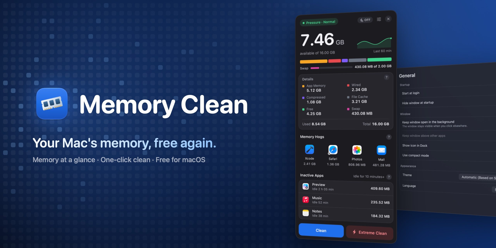
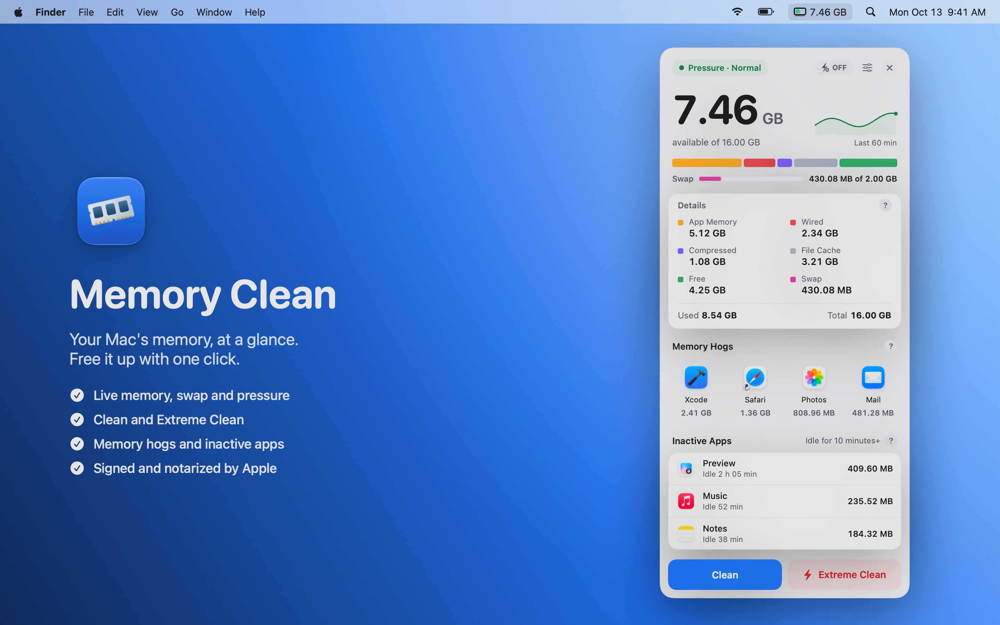
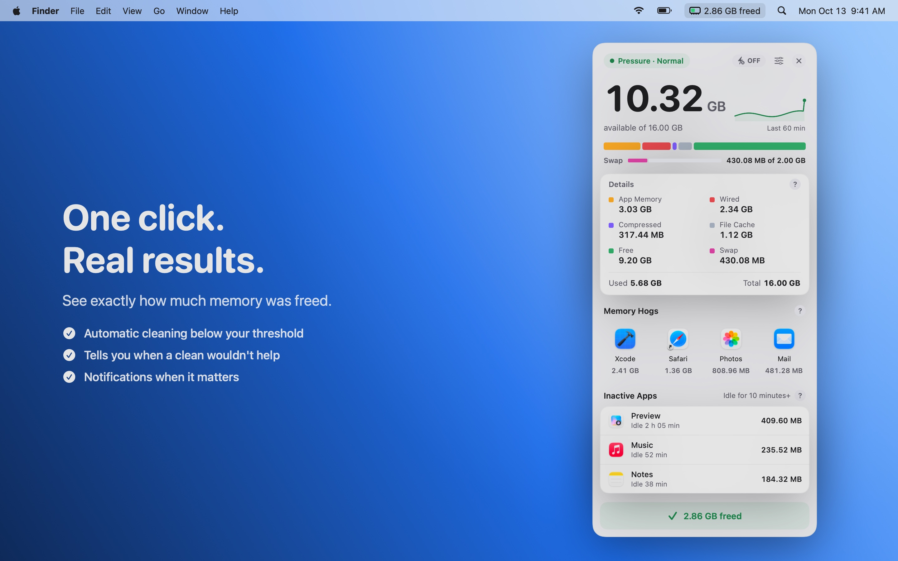
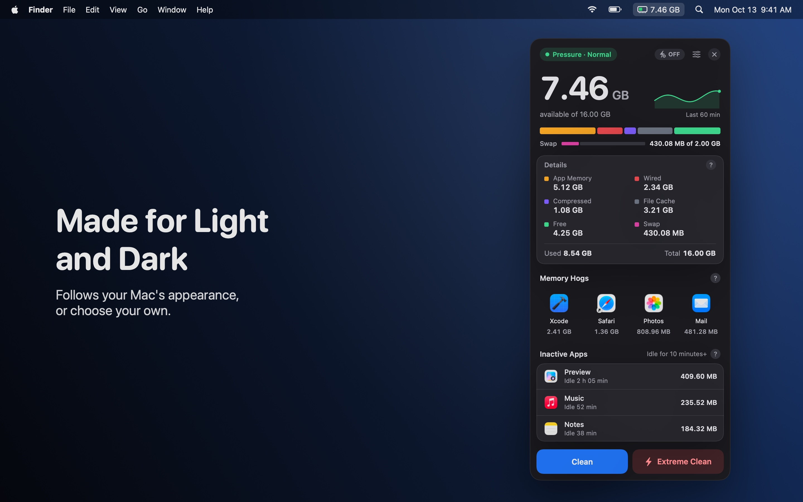
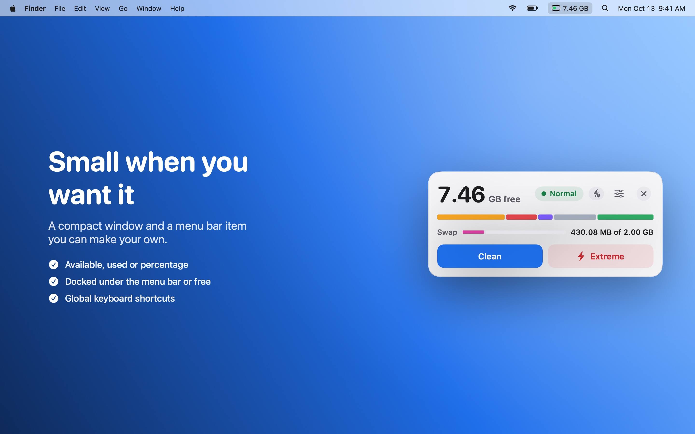
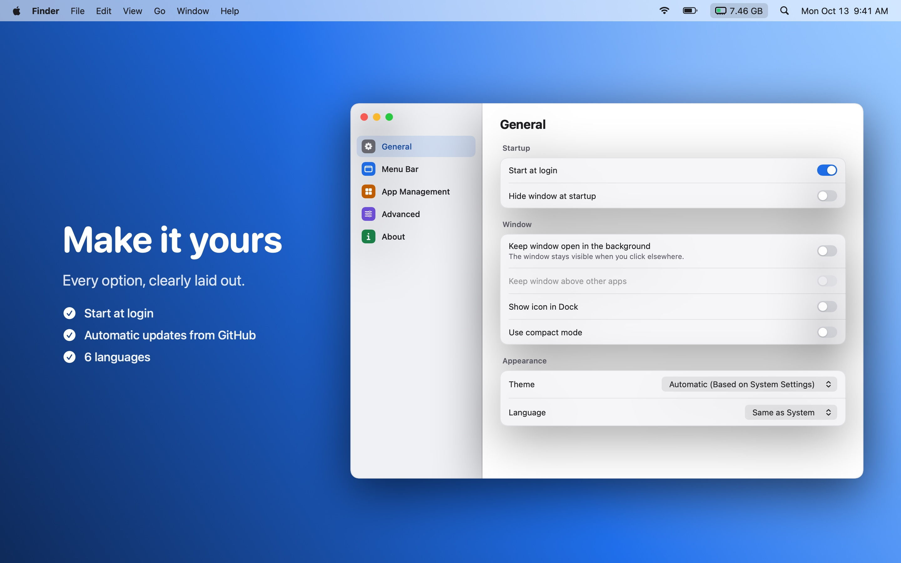

  

<h1 align="center">Memory Clean</h1>

  Keep an eye on your Mac's memory from the menu bar, and free it with one click.

  <a href="https://github.com/DevDreamer99/Memory-Clean-Releases/releases/latest"><b>⬇︎ Download the latest version</b></a>
  &nbsp;·&nbsp; macOS 14 Sonoma or later &nbsp;·&nbsp; Apple silicon &amp; Intel

---

  

<table>
  <tr>
    <td></td>
    <td></td>
  </tr>
  <tr>
    <td></td>
    <td></td>
  </tr>
</table>

## Install

1. Download the `.dmg` from the [latest release](https://github.com/DevDreamer99/Memory-Clean-Releases/releases/latest).
2. Open it and drag **Memory Clean** into **Applications**.
3. Open Memory Clean: it lives in the menu bar.

The app checks this page once a day and, when a new version is out, installs it for you with one click (you can turn the check off in Settings).

## Features

- **Live memory at a glance**: available memory in the menu bar; app memory, wired, compressed, file cache, free and swap in the window, with a chart of the last hour and the system's memory pressure.
- **Clean and Extreme Clean**: frees memory held by inactive pages and caches. Memory Clean tells you when a clean wouldn't help (swap almost full, or plenty already available) instead of running it for nothing.
- **Automatic cleaning**: below a threshold you choose, with a cooldown so it never runs too often.
- **Memory hogs**: the apps using the most memory, one click to bring them to the front.
- **Inactive apps**: apps you haven't used for a while, with an optional notification to quit them.
- **Your way**: detailed or compact window, docked under the menu bar icon or free, light/dark theme, menu bar text and size.
- **Languages**: English, Italiano, Français, Deutsch, Español, 简体中文.

## Safe by design

- **Signed with a Developer ID and notarized by Apple**: macOS checks every download.
- **No data collected, no account, no analytics.** The only network request is the daily check of this page for updates.
- **No administrator password, no background helpers.** It never quits an app on its own: only when you choose *Quit*.

## Requirements

| Version | macOS | Macs |
|---|---|---|
| 1.0.1 and later | 14 Sonoma or later | Apple silicon and Intel |
| 1.0.0 | 27 or later | Apple silicon |

## What's new

**1.0.5**
- Settings always open in the middle of the screen you're using.

**1.0.4**
- Updates install from inside the app: *Install and Relaunch* downloads the new version, checks it's signed and notarized, and reopens.
- Started at login, it stays in the menu bar without opening its window.

**1.0.3**
- Large values (10 GB and more) no longer wrap in the window.

**1.0.2**
- The menu bar item uses the standard macOS width and margins.

**1.0.1**
- Runs on macOS 14 Sonoma and later, on Apple silicon and Intel Macs.
- Warns you when a clean wouldn't help, and skips useless automatic cleans.
- The window stays open while a clean runs; the result is always shown.

**1.0.0**
- First release.

---

© 2026 Mattia Fossati

